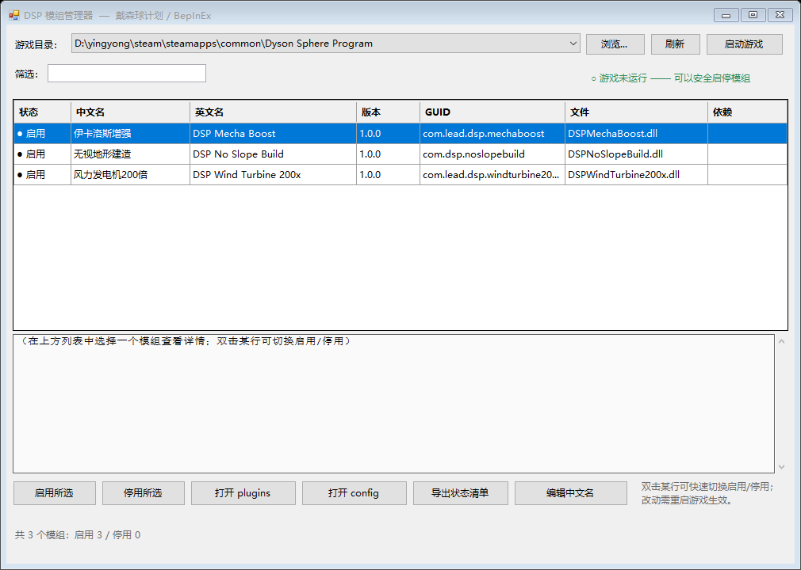

# DSP 模组管理器

> 戴森球计划（Dyson Sphere Program）BepInEx 模组管理器

独立 GUI 工具，用来管理 `BepInEx\plugins` 下的模组：**一键启用 / 停用**、查看元数据、依赖检查、中文名显示。

**不注入游戏进程、不修改游戏原文件、不删除任何模组文件。**

---

## 界面



| 状态 | 中文名 | 英文名 | 版本 | GUID | 文件 |
|---|---|---|---|---|---|
| 启用 | 伊卡洛斯增强 | DSP Mecha Boost | 1.0.0 | com.lead.dsp.mechaboost | DSPMechaBoost.dll |
| 启用 | 无视地形建造 | DSP No Slope Build | 1.0.0 | com.dsp.noslopebuild | DSPNoSlopeBuild.dll |
| 启用 | 风力发电机200倍 | DSP Wind Turbine 200x | 1.0.0 | com.lead.dsp.windturbine200x | DSPWindTurbine200x.dll |

---

## 功能

- 列出全部模组（**含已停用的**），显示中文名 / 英文名 / 版本 / GUID / 文件名 / 依赖
- **一键启用 / 停用**，支持多选，双击某行也能切换
- **依赖检查**：停用前提示哪些已启用模组依赖它；启用状态下也会报告依赖缺失
- **游戏运行检测**：跑着游戏时自动锁定启停按钮
- 一键从 Steam 启动游戏（`steam://rungameid/1366540`）
- 打开 `plugins` / `config` 目录
- 导出模组状态清单
- **中文名**：内置已收录模组，其余可用 `mod-names.txt` 对照表自行补充

## 安全设计

工具会操作真实的游戏目录，所以有几条硬约束：

| 约束 | 说明 |
|---|---|
| **只改名，绝不删除** | 停用 = `X.dll` 移到 `disabled\X.dll.disabled`；启用 = 移回去。BepInEx 只加载 `plugins` 根目录下的 `.dll`，改名即停用 |
| **游戏运行中禁止改动** | 检测到 `DSPGAME.exe` 就拒绝操作并置灰按钮 |
| **绝不覆盖同名文件** | 启用时若已存在同名 DLL，直接拒绝并提示 |
| **批量操作相互隔离** | 某个模组失败不影响其他，最后汇总报告 |
| **不执行模组代码** | 用 Mono.Cecil 纯元数据读取 `[BepInPlugin]`，不做 `Assembly.LoadFrom` |

---

## 使用

1. 下载 Release 里的 `DSP-Mod-Manager-v*.zip`，解压到任意位置
2. 双击 `DSPModManager.exe`
3. 自动探测 Steam 库中的游戏目录；找不到就点「浏览...」手动选择（含 `DSPGAME.exe` 的那一层）
4. 选中模组后启用 / 停用，**重启游戏生效**

### 中文名

界面显示 `中文名（English Name）`。点「**编辑中文名**」会打开 exe 同级的 `mod-names.txt`：

```
# 格式：<GUID 或 DLL文件名> <Tab> <中文名>
# 行尾 # 之后是注释，不会被当成名字

com.lead.dsp.mechaboost        伊卡洛斯增强
com.dsp.noslopebuild           无视地形建造
com.lead.dsp.windturbine200x   风力发电机200倍
```

保存后回到管理器点「确定」即可刷新。**重新生成模板不会覆盖你已填的内容。**

为什么只内置三个模组的中文名？因为猜错名字比不显示更糟（会让你以为装错了模组）。其余留空，由你按需补充。

---

## 系统要求

- Windows x64
- .NET Framework 4.0+（Win10 / 11 自带）
- 游戏已安装 BepInEx 5.x

---

## 从源码构建

需要 Microsoft.Net.Compilers.Toolset（Roslyn）放在 `tools/roslyn/tasks/net472/csc.exe`。

```powershell
powershell -ExecutionPolicy Bypass -File src\build.ps1
# 输出 build\DSPModManager.exe
```

系统自带的 `C:\Windows\Microsoft.NET\Framework64\v4.0.30319\csc.exe` 只支持 C# 5，编译不了本项目，所以用 Roslyn。

### 运行测试

```powershell
powershell -ExecutionPolicy Bypass -File probe\run-tests.ps1
```

- `CoreTests.cs` — 32 项：目录校验、扫描、启停幂等、冲突保护、坏文件容错、依赖分析、状态导出
- `NameTests.cs` — 17 项：内置中文名、外部覆盖、行尾注释剥离、模板生成、显示格式
- `LayoutDump.cs` — 打印控件树与实际坐标，排查布局问题
- `ShotTool.cs` — 用 `DrawToBitmap` 把窗体渲染成 PNG（不受窗口遮挡影响）

---

## 项目结构

```
src/
  MainForm.cs              WinForms 界面（TableLayoutPanel 确定性布局）
  ModManager.cs            扫描 / 启停 / 依赖分析（无 UI 依赖，可单测）
  ModNameLocalizer.cs      中文名解析与对照表模板生成
  PluginMetadataReader.cs  Mono.Cecil 元数据读取
  build.ps1                构建脚本
probe/                     离线测试（不碰真实游戏目录）
docs/                      截图
```

设计上把**纯逻辑**（`ModManager` / `ModNameLocalizer`）和 **UI**（`MainForm`）彻底分开，所以核心行为能在临时目录里跑自动化测试，不需要真游戏。

---

## 已知问题 / 设计取舍

- 启用时若 `plugins` 根目录已有同名 DLL，会**拒绝**而不是覆盖 —— 这种情况通常是重复下载，需要你自己判断留哪个
- 读不出元数据的 DLL 会标黄显示，但仍可正常启停（启停只依赖文件名）
- 修改模组状态**必须重启游戏**才生效，这是 BepInEx 的机制

---

## License

MIT
